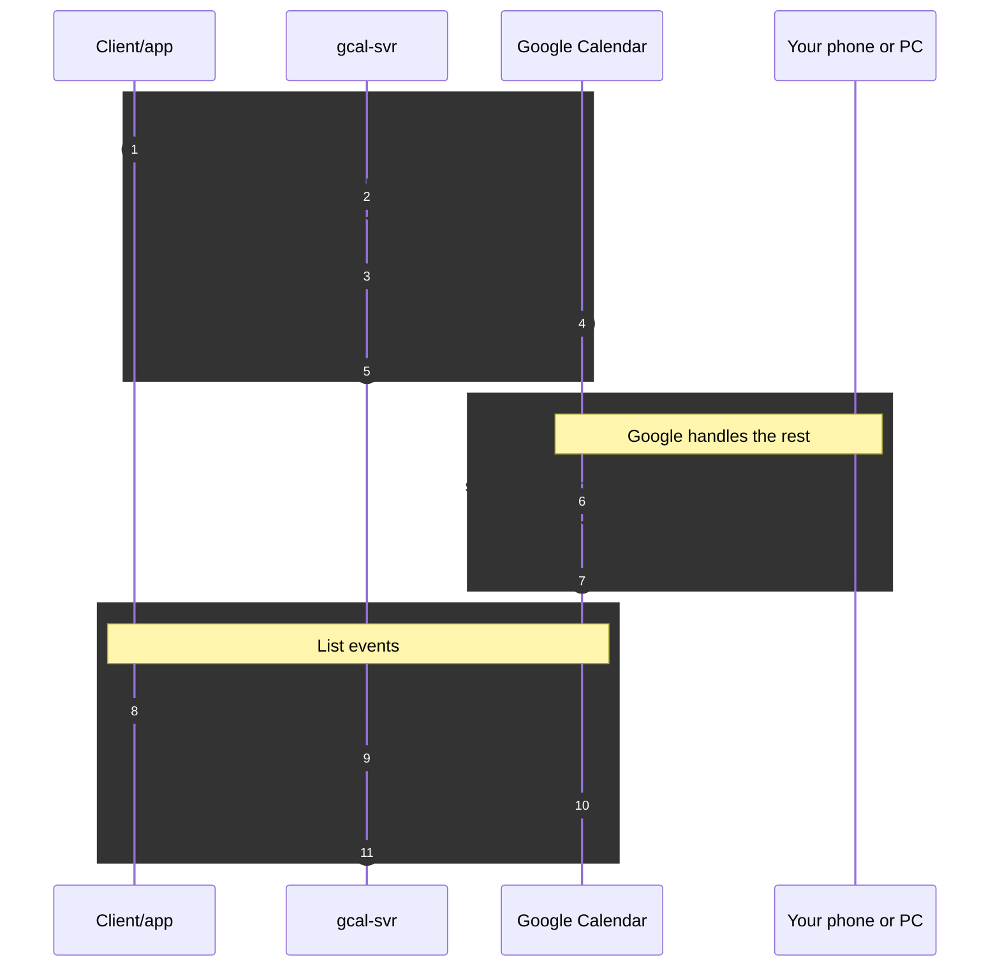

<pre align="center" style="color:cyan; font-weight:bold;">

██████╗   ███████╗  ███████╗ ██╗     
██╔════╝  ██╔════╝  ██╔══██╗ ██║     
██║  ███╗ ██║       ███████║ ██║     
██║   ██║ ██║       ██╔══██║ ██║     
╚██████╔╝ ╚██████╗  ██║  ██║ ███████╗
╚═════╝   ╚══════╝  ╚═╝  ╚═╝ ╚══════╝


</pre>


<p align="center">
  <b>Gcal Server</b>
</p>

Turns a casual English reminder into a Google Calendar event. Used by
[gcal-app](https://github.com/kushal1o1/gcal-app). No LLM is involved: the
phrase is parsed by a deterministic regex grammar, so the same input always
gives the same event.

## Architecture



The server keeps no database and runs no scheduler. Google Calendar stores
the events, fires the reminders, and sends the notifications.

## Self-hosting

This server writes to **one** Google Calendar, the one shared with its service
account. Anyone who has the server URL and `API_TOKEN` can create and delete
events on that calendar.

- Run your own deployment with your own service account, calendar and token.
- Do not share a deployment URL or token publicly.

## Config

| Var | Purpose |
|---|---|
| `TIMEZONE` | IANA time zone for event times. Default `Asia/Kathmandu`. |
| `GCAL_SERVICE_ACCOUNT_B64` | base64 of the service-account JSON (used on Vercel) |
| `GCAL_SERVICE_ACCOUNT_FILE` | path to key file (local alternative) |
| `GCAL_CALENDAR_ID` | shared calendar id the service account writes to |
| `API_TOKEN` | shared secret the app sends as a Bearer token |

Local runs also auto-detect `./gcal-service-key.json`. The template is in
`.env.example`. Never commit the raw service-account key or `.env`.

## API

Full endpoint reference: [docs/API.md](docs/API.md).


## Tests

```bash
go test ./...
```

`internal/nlu/corpus_test.go` is a table of real phrases with their expected
output. When a phrase is parsed wrongly, add it there first.

## Related

- [gcal-app](https://github.com/kushal1o1/gcal-app): the Flutter mobile app that
  calls this server.
